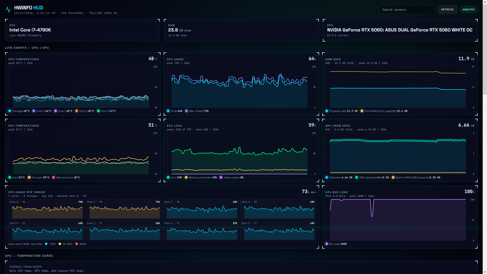

# HWiNFO HUD

A live hardware dashboard built on top of **HWiNFO64 shared memory**, a **Python reader**, a **FastAPI + WebSocket server**, and a browser UI tuned for readable real-time telemetry.



## What this repo is

This project reads sensor data from HWiNFO64 and streams it into a custom dashboard.

Pipeline:

```text
HWiNFO64 Shared Memory
  -> Python ctypes reader
  -> FastAPI server
  -> WebSocket stream
  -> Browser HUD
```

## Current app structure

```text
hwinfo-monitor/
├── .gitignore
├── CHANGELOG.md
├── README.md
├── reader.py
├── requirements.txt
├── server.py
├── docs/
│   └── screenshot.png
└── static/
    └── index.html
```

## Requirements

- Windows
- HWiNFO64 running (tested with HWiNFO64 **v8.54**)
- HWiNFO Sensor window open
- **Shared Memory Support** enabled in HWiNFO
- Python 3.10+ (tested with Python **3.14.5**, FastAPI 0.143.0, uvicorn 0.54.0)

## Setup

### 1. Enable HWiNFO shared memory

In HWiNFO64:

- Open **Settings**
- Go to **Sensors**
- Scroll down
- Enable **Shared Memory Support**

### 2. Install dependencies

```bash
cd hwinfo-hud
pip install -r requirements.txt
```

### 3. Run the server

```bash
python server.py
```

Then open:

```text
http://127.0.0.1:8080
```

The server listens on `0.0.0.0:8080`, so the HUD can also be opened from another device on the same network (phone, tablet, second PC) at `http://<your-pc-ip>:8080`. Windows Firewall may ask to allow Python on first run. Allow it for private networks only. If you don't want LAN access, change `host` in `server.py` back to `127.0.0.1`.

## Live charts

The top of the dashboard is a full-width grid of live charts sized to fit a single 1080p screen (3 per row, 2 below 1400px, 1 below 900px). Each chart keeps a rolling 120-sample history (about 2 minutes at the default 1s stream).

| Row | Charts |
|---|---|
| CPU / system | **CPU temperatures** (package + per core) · **CPU usage** (total + max thread) · **RAM used** (physical + committed incl. pagefile) |
| GPU | **GPU temperatures** (core, hot spot, memory junction) · **GPU load** (core, memory controller, video engine, % of TDP) · **GPU VRAM used** (allocated, D3D dedicated, D3D dynamic) |
| Detail | **CPU usage per thread** (grid of mini graphs, one column per core) · **GPU bus load** (PCIe, autoscaled) |

Notes:
- Cores and threads are detected from the HWiNFO readings, including Intel P-core / E-core naming.
- Charts with a missing sensor show "Sensor not found in HWiNFO" instead of breaking.
- **D3D dynamic** is GPU memory the driver keeps in system RAM. If it grows while VRAM is full and bus load spikes, VRAM is spilling over PCIe and you will likely see stutter.
- **GPU bus load** is PCIe link utilization. Sustained 80–100% under load means the GPU is waiting on data, which is common for x8 cards on older PCIe 3.0 platforms.
- The default order is set by `CHART_ORDER` in `static/index.html`, and new charts are one entry in the `CHARTS` array.

### Customizing the layout

Every block on the page can be moved and resized: the CPU / RAM / GPU summary cards, each live chart, the thermal trend graph, CPU package, CPU utilization, the GPU hub, Memory, Storage and Health summary.

Click **Edit layout** in the top bar:

- **Move**: drag any block. A glowing marker shows where it will land, and the block moves when you release. Hold it near the top or bottom edge of the window to scroll the page.
- **Resize**: drag the corner handle at the bottom right. Width is free, from about 220px up to the full row, and it briefly snaps to 1/3, 1/2, 2/3 and full width so blocks line up easily. Height is free too (60–600px). A block made shorter than its content gets a scrollbar. A narrower block leaves room next to it instead of filling the row, and blocks in the same row stretch to the same height.
- **Width buttons**: **−** / **+** next to the size label jump between 1/3, 2/3 and full width. This also works for blocks at the right edge, where there is no room to drag.
- **Done** leaves edit mode, and **Reset** restores the default layout.

The layout is saved in the browser's `localStorage`, so each browser or device keeps its own arrangement. Widths are stored as a share of the row, so a layout looks the same on another resolution. Below 900px every block takes the full width. A charts-only layout saved by an earlier version is carried over automatically.

## API

- `GET /` -> dashboard
- `GET /api/sensors` -> full HWiNFO data snapshot
- `GET /api/readings` -> current flat readings list
- `GET /api/debug` -> shared memory diagnostics
- `WS /ws` -> live telemetry stream

## How we made it work

The main technical problem was not the UI. It was the shared memory bridge.

### Final working setup

- Shared memory mapping name: `Global\HWiNFO_SENS_SM2`
- Mutex name: `Global\HWiNFO_SM2_MUTEX`
- Signature constant: `0x53695748` (`HWiS`)
- Reader implementation: `ctypes` structs matching the HWiNFO SDK layout
- Transport: polling shared memory on the server side, then broadcasting through WebSocket

### Important lessons

1. **The struct layout had to match exactly**
   - Wrong offsets or field sizes break everything.
   - The reader now uses packed `ctypes.LittleEndianStructure` definitions.

2. **The signature check mattered**
   - Earlier attempts used the wrong signature expectation.
   - The live mapping signature that worked here is `0x53695748`.

3. **Privilege level must match**
   - If HWiNFO runs elevated and Python does not, or vice versa, shared memory access can fail.

4. **The sensor window must be open**
   - HWiNFO needs to be actively exposing the sensor shared memory.

5. **A browser HUD needs selective data, not raw dumps**
   - HWiNFO exposes a lot of duplicate, low-value, or zero-value readings.
   - The frontend now filters and deduplicates where helpful.

## Design methodology

This dashboard is being shaped around a few rules.

### 1. Real-time readability over raw completeness

Not every sensor belongs on screen.

We prefer:
- the most useful temperatures
- meaningful power and load values
- deduplicated storage entries
- layouts that stay readable while values update live

We avoid:
- repeated copies of the same drive
- zero-only metrics
- noisy panels that make the dashboard harder to scan

### 2. Motion-friendly visualizations

For fast-changing telemetry, a graph should:
- stay within the layout
- be readable at a glance
- update smoothly
- preserve trend, not just current value

That is why the HUD moved away from overstuffed static cards and oversized graphs toward simpler live views.

### 3. Futuristic look, practical information

The visual style is intentionally sci-fi:
- deep-space dark background
- cyan glow accents
- glass panels
- bracket corners
- mono + geometric heading fonts

But the goal is still utility first. If something looks cool but hurts readability, it should be removed.

## Current UI direction

The interface currently focuses on:
- a one-screen **live charts grid** for CPU, GPU and RAM
- a simplified **live temperature graph**
- cleaner GPU detail panels
- filtered storage cards
- a more readable futuristic HUD styling language

## Notes for future work

Likely next improvements:
- longer or configurable chart history
- better grouping of high-value GPU metrics
- more explicit sensor selection rules in the frontend
- optional compact and expanded dashboard modes

## Repo cleanup policy

This repo intentionally keeps only the files needed to run and maintain the app.

One-off diagnostic scripts were removed after the shared memory bridge was stabilized. Their findings are documented here and in `CHANGELOG.md` instead of being left as repo clutter.
